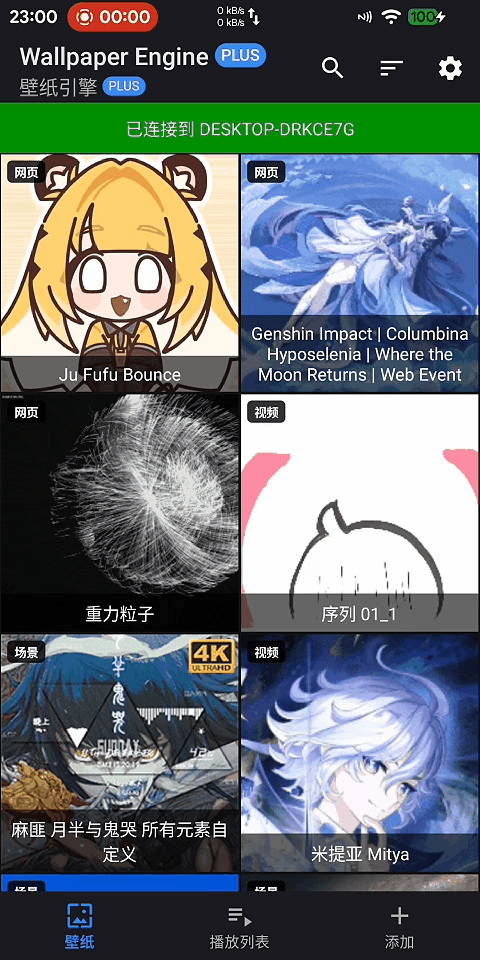
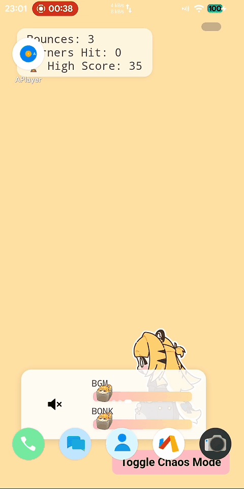
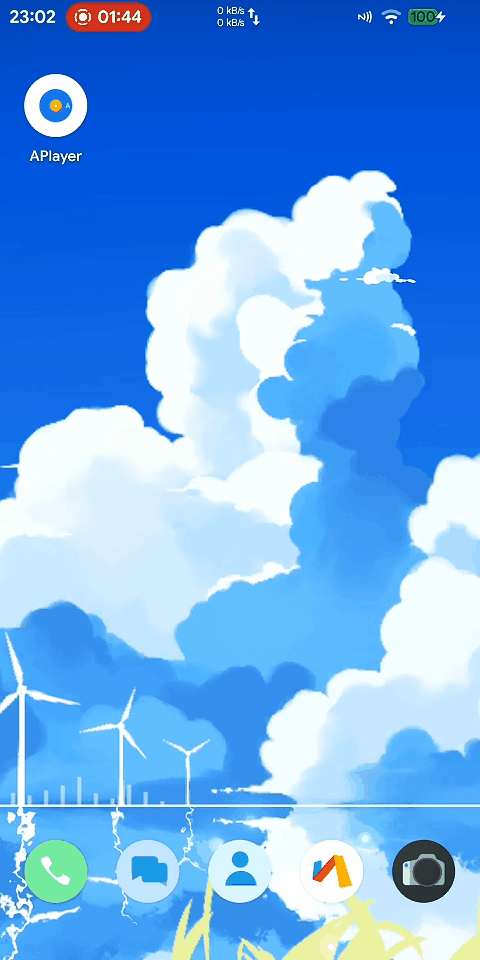
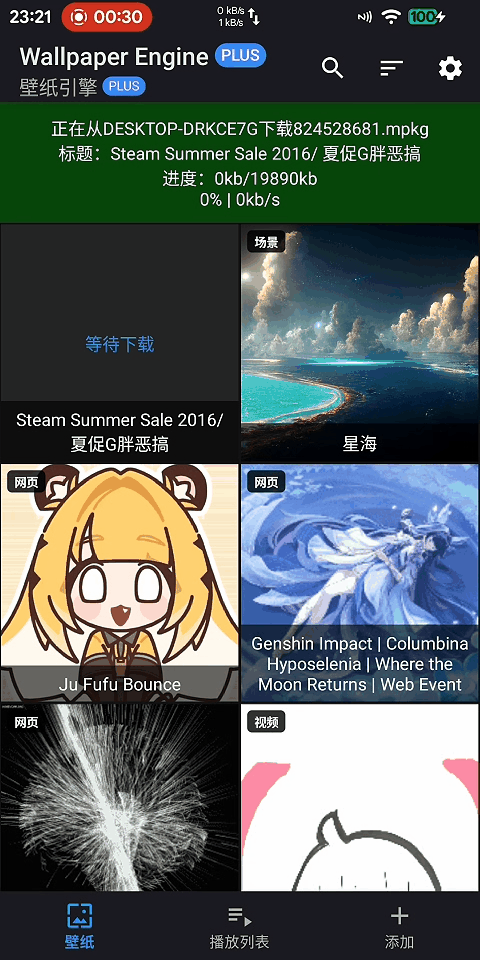
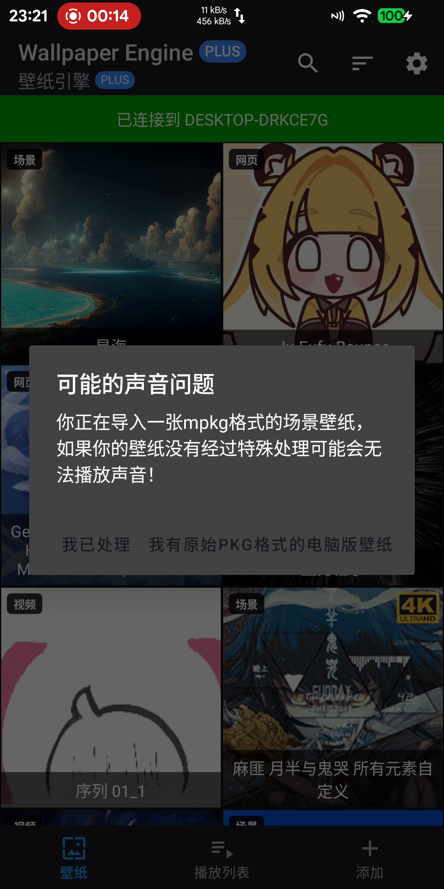
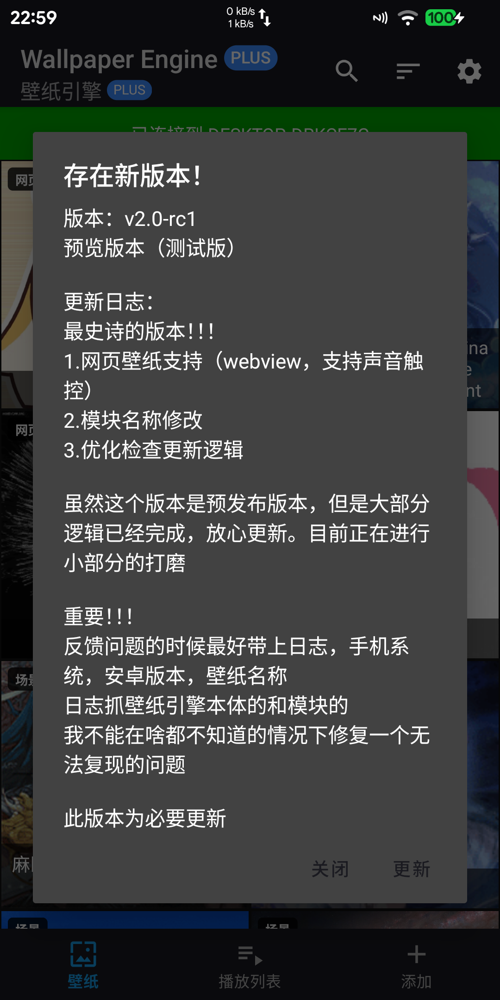
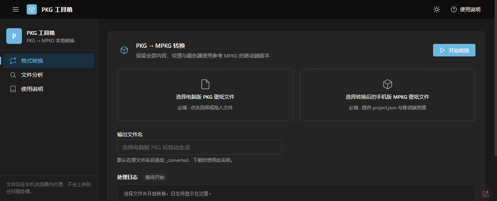

# WallpaperEnginePlus


[English](#english) | [中文](#中文)

---

## 中文

### 简介

WallpaperEnginePlus 是一个面向 **Wallpaper Engine for Android** 的 Xposed 增强模块。它在修复原版声音问题的同时，为 Android 客户端补上了网页壁纸（Web Wallpaper）支持：导入、预览、应用到桌面，以及完整的自定义选项与显示设置。

- 作用域：`io.wallpaperengine.weclient` / `io.wallpaperengine.nxdyy`

### 功能特性

#### 网页壁纸

- **ZIP 导入**：在「添加」页面选择「导入网页壁纸」，自动解压并校验工程文件
- **列表集成**：导入的壁纸出现在壁纸列表中，显示工程内的预览图，并在左上角标注「网页」类型
- **应用内预览**：预览页直接渲染网页（系统 WebView），支持触摸、滑动、点击等交互
- **应用到桌面**：预览页右上角勾选 → 系统壁纸预览 → 设置壁纸，由模块接管桌面渲染
- **渲染优化**：虚拟显示 + Presentation + WebView，不使用本地 HTTP 服务器
- **帧率限制**：可为网页壁纸单独设置 10~60 FPS 上限，降低功耗
- **渲染精度**：50%~100% 可调，按比例缩小布局后放大，兼顾画质与性能
- **网页大小（每壁纸独立）**：跟随屏幕 / 16:9 / 16:10 / 4:3 / 3:2 / 21:9 / 1:1 / 9:16
- **位置调节**：非屏幕比例时按 cover 铺满，可水平/垂直平移显示区域
- **自定义选项**：读取 `project.json` 的 `general.properties`，在预览页底部抽屉中提供开关、滑块、下拉框、文本输入等设置，实时推送给网页
- **多语言**：属性标题按系统语言读取 `general.localization`（zh-chs / zh-cht / en-us 等），说明文字支持 HTML
- **音频同步**：壁纸暂停时同步暂停页面内 audio/video 与 Web Audio，恢复时续播；退出预览立即静音
- **数据清理**：设置中提供「清除网页壁纸数据」，清理 localStorage、Cookie、HTTP 缓存与 IndexedDB
- **动态 GIF 封面**：`preview.gif` 在壁纸列表中直接播放动画，不再是静态第一帧
- **详情页**：文件详情显示网页壁纸的大小、类型、分辨率与当前 FPS 限制
- **长按分享**：网页壁纸自动打包为 ZIP 后分享，兼容 FileProvider 冲突的环境

#### 声音修复

- 修复视频壁纸的音轨播放
- 修复场景壁纸中视频元素的音轨播放
- 修复场景壁纸中独立音频对象（Sound）的播放
- 在壁纸引擎设置中注入「壁纸音量」滑条（0-100），修改即时生效
- 壁纸暂停/恢复时自动同步音频状态

#### 界面与增强

- **PLUS 标识**：壁纸引擎主页标题与副标题显示醒目的 PLUS 徽章，切换底栏页面后保持
- **设备名标识**：连接电脑时上报的设备名带 `[WEP]` 前缀，方便在电脑端识别
- **来源询问**：首次打开时确认下载渠道，非官方渠道提供举报与作者主页入口
- **更新检查**：打开应用只请求 `version`，发现新版本后才请求 `updateinfo`；每个版本显示一次 `logv<版本号>` 更新日志

### 演示

| 动态 GIF 封面 | 网页壁纸（可交互） |
|:---:|:---:|
|  |  |

| 场景壁纸（有声音） | 下载进度显示 |
|:---:|:---:|
|  |  |

| 传输后提示 | 更新提示 |
|:---:|:---:|
|  |  |

### 网页壁纸使用说明

#### ZIP 包结构

压缩包根目录需要包含：

| 文件 | 是否必需 | 说明 |
|------|---------|------|
| `project.json` | 必需 | 必须是合法 JSON，`type` 为 `web` 或 `file` 指向存在的 HTML |
| `index.html` | 必需 | 网页入口（或由 `project.json` 的 `file` 指定） |
| `preview.gif` / `preview.png` / `preview.webp` / `default.webp` 等 | 至少一张 | 列表缩略图 |
| `project.json` 引用的资源 | - | JS、CSS、图片、音频等按相对路径打包 |

`main.js` 不是必需文件。导入时会校验路径穿越、文件数量（≤3000）与解压大小（≤200MB）。

#### 导入与应用

1. 打开壁纸引擎 → 底部「添加」→「导入网页壁纸」
2. 选择 ZIP 文件，导入成功后列表自动刷新，条目显示「网页」角标
3. 点击条目进入预览，页面底部蓝色把手可展开属性抽屉
4. 抽屉第一项为「网页大小」，其后是该壁纸的自定义选项
5. 点击右上角勾选 → 系统壁纸预览界面 →「设置壁纸」→ 选择主屏幕

#### 全局设置（壁纸引擎 → 设置 → 常规）

- **壁纸音量**：修复视频/场景壁纸的声音（默认 100）
- **网页壁纸帧率限制**：10~60 FPS（默认 20）
- **网页壁纸渲染精度（％）**：50~100（默认 100）
- **清除网页壁纸数据**：位于常规分组最后，清除网页壁纸保存的设置、Cookie 与浏览器缓存

### 常见问题

**导入后列表没有出现？**
确认压缩包根目录包含合法的 `project.json` 与预览图；返回上一级重新进入列表即可刷新。

**点击应用后仍是旧壁纸？**
模块会严格使用当前选中的壁纸；如桌面未更新，重新进入预览并应用一次。

**预览一直加载或黑屏？**
网页壁纸首次加载需要初始化 WebView，稍等片刻；若使用较低的渲染精度或帧率，加载速度会更快。

**退出预览后仍有声音？**
1.5 版本已在页面脚本执行前注入媒体守卫，暂停时会拦截页面自动重试的 `play()`，并在退出时销毁 WebView。若仍遇到，请在预览页抽屉把「背景音乐」关闭，或使用「清除网页壁纸数据」后重试。

**壁纸保存的设置会丢失吗？**
不会。同一壁纸始终使用固定的虚拟域名，`localStorage` / IndexedDB 在重载、重启后都会保留。

**划掉后台后桌面壁纸变黑/应用闪退？**
1.5 版本已处理 WebView 渲染进程被系统回收的情况：应用不再被终止，壁纸会在恢复可见时自动重建。

### 技术原理

#### 网页壁纸渲染

```
WallpaperService Surface ← VirtualDisplay ← Presentation(FrameLayout) ← WebView
                                                    ↑
                                   https://<固定虚拟域名>/index.html
                                                    ↑
                          WebViewClient.shouldInterceptRequest 直接读取壁纸目录
```

- 不使用本地 HTTP 服务器：`targetSdk 35` 禁止明文 HTTP，且拦截请求性能更好
- 同一壁纸目录使用固定虚拟域名（目录名 MD5），保证 `localStorage` 等按 origin 隔离的数据可持久
- 每个 WallpaperService Engine 独立渲染器；同一 Surface 只允许一个生产者，避免画面跳动
- 渲染进程被系统回收时返回 `onRenderProcessGone` 处理，不再导致应用被终止
- 渲染精度通过「缩小布局 + 放大绘制」实现，不改变虚拟屏尺寸

#### 媒体暂停守卫

在 HTML 的 doctype 之后注入脚本（早于页面脚本执行）：

- 记录所有 `AudioContext`，暂停时 `suspend()`，恢复时 `resume()`
- 暂停期间拦截 `HTMLMediaElement.play()`，并记录被拦截的媒体
- 恢复时重新播放暂停前正在播放、以及暂停期间尝试播放的媒体

#### 自定义选项

- 读取 `project.json` 的 `general.properties` 默认值
- 读取壁纸引擎保存的 `wp_properties_<filePath>` 用户值并覆盖
- 页面加载完成后调用 `window.wallpaperPropertyListener.applyUserProperties({...})`
- 监听偏好变化，修改后实时推送；暂停/恢复时调用 `setPaused()`
- 属性标题按 `general.localization` 选择系统语言译文，并按 HTML 解析

#### 声音修复

**路径 A：视频壁纸修复（Java 层）**

- Hook `MediaPlayer.setVolume`，拦截静音调用 `(0, 0)`，替换为用户设置的音量
- deoptimize 调用方，防止 hook 被内联优化失效

**路径 B：场景音频修复（Native 层）**

1. 从 `/proc/self/maps` 定位 `libscenejni.so` 加载基址
2. 解析进程内存中的 ELF64 结构（program headers、dynamic 段、dynsym）
3. 找到 `_ZTV22AndroidMediaExtensions` 虚表与 13 个音频函数的运行时地址
4. 校验虚表槽位一致性
5. `mprotect` 修改虚表内存权限，替换为自定义实现
6. 自定义实现通过 JNI 桥接到 Java 层 `SoundBridge`（`MediaPlayer`）

**路径 C：暂停同步**

- Hook `GLWallpaperEngine.updatePausedState`
- 暂停时同步停止 `AudioRecorder`（FFT 采集）与所有声音，恢复时同步启动

### 声音修复范围

| 壁纸类型 | 视频音轨 | 场景音频 |
|---------|---------|---------|
| 视频壁纸 | ✓ | - |
| 场景壁纸（含视频元素） | ✓ | ✓ |
| 纯场景壁纸 | - | ✓ |

> **注意**：场景音频修复仅支持 **arm64-v8a** 架构设备
>
> **重要**：直接通过电脑版 Wallpaper Engine 导出的场景壁纸文件**不包含音频文件**，必须手动转换（例如使用 [PKG 工具箱](https://project.nxdyy.cn/WallpaperEngineSoundFix/) 或 [pkg2mpkg](https://github.com/nxdyy/pkg2mpkg) 转为手机版 MPKG）后才能听到声音。

### 环境要求

- Android 9.0+（API 28+）
- LSPosed 或其他支持 Xposed API v101 的框架
- Wallpaper Engine for Android（包名：`io.wallpaperengine.weclient`）
- arm64-v8a 架构设备（用于场景音频修复）
- 系统 WebView（Android System WebView / Chrome）

### 下载

#### 方式一：GitHub Releases（推荐）

1. 访问 [Releases 页面](https://github.com/nxdyy/WallpaperEnginePlus/releases)
2. 下载最新版本的 APK 并安装

#### 方式二：私有下载站（免登录、不限速）

[https://pan.nxdyy.cn/](https://pan.nxdyy.cn/)

#### 方式三：123 云盘

[https://1816907939.share.123pan.cn/123pan/7lCyVv-EWEY?pwd=bili# 提取码：bili](https://1816907939.share.123pan.cn/123pan/7lCyVv-EWEY?pwd=bili#)

#### 方式四：自行构建

```bash
git clone https://github.com/nxdyy/WallpaperEnginePlus.git
cd WallpaperEnginePlus

# 构建 Release APK
./gradlew assembleRelease

# APK 输出路径
# app/build/outputs/apk/release/app-release.apk
```

### 安装使用

1. 安装 APK
2. 在 LSPosed 管理器中启用本模块
3. 作用域勾选「Wallpaper Engine」
4. 强制停止 Wallpaper Engine 并重新打开（模块代码会在新进程中加载）
5. 首次打开会显示来源提示与当前版本更新日志
6. 打开壁纸引擎设置 → General：
   - 「壁纸音量」：修复视频/场景壁纸声音
   - 「网页壁纸帧率限制」「网页壁纸渲染精度」：调整网页壁纸性能
7. 在「添加」页面导入网页壁纸 ZIP

### 项目结构

```
app/src/main/
├── cpp/
│   ├── CMakeLists.txt              # Native 构建配置
│   └── soundfix.cpp                # Native 层虚表替换实现
├── java/io/wallpaper/soundfix/
│   ├── HookEntry.kt                # Xposed 入口与全部 Hook
│   ├── WebWallpaper.kt             # 网页壁纸渲染、属性、媒体守卫
│   ├── GifPreview.kt               # 列表封面 GIF 动画
│   ├── WallpaperTypeBadge.kt       # 壁纸类型角标
│   ├── PropertyLocalization.kt     # 属性文案本地化
│   ├── SceneImportWarning.kt       # 场景包导入提示
│   ├── DownloadProgress.kt         # 列表顶部传输进度
│   ├── MainActivity.kt             # 模块主界面
│   ├── StatusProvider.kt           # 激活状态上报
│   ├── SoundBridge.kt              # Java 层音频桥接
│   └── SoundFixNative.kt           # Native 方法声明
└── resources/META-INF/xposed/
    ├── java_init.list              # Xposed 初始化配置
    ├── module.prop                 # 模块属性
    └── scope.list                  # 作用域配置
```

### 相关工具

**PKG 工具箱**：在浏览器中把电脑版 PKG 场景壁纸转换为手机版 MPKG（保留全部属性与音效），文件仅在本地处理，不会上传。



- [pkg2mpkg](https://github.com/nxdyy/pkg2mpkg)（本地转换工具）
- 在线转换：[project.nxdyy.cn/WallpaperEngineSoundFix](https://project.nxdyy.cn/WallpaperEngineSoundFix/)

### 依赖

- [libxposed-api](https://github.com/libxposed/api) v101.0.1 - Xposed API
- AndroidX AppCompat
- Material Design Components

---

## English

### Introduction

WallpaperEnginePlus is an Xposed enhancement module for **Wallpaper Engine for Android**. Besides fixing the original sound issues, it adds full web wallpaper support to the Android client: importing, previewing, applying to the home screen, custom properties and display options.

- Scope: `io.wallpaperengine.weclient` / `io.wallpaperengine.nxdyy`

### Features

#### Web wallpapers

- **ZIP import** from the "Add" page, with archive validation
- **List integration**: imported wallpapers appear with their preview image and a "Web" badge
- **In-app preview** rendered by the system WebView, with touch and gesture support
- **Apply to home screen** through the system wallpaper preview screen
- **Rendering** via VirtualDisplay + Presentation + WebView, without a local HTTP server
- **FPS limit** (10–60) and **render scale** (50–100%) for web wallpapers
- **Per-wallpaper web size**: screen / 16:9 / 16:10 / 4:3 / 3:2 / 21:9 / 1:1 / 9:16
- **Position adjustment** with horizontal/vertical sliders when the aspect ratio differs from the screen
- **Custom properties** from `project.json` (`bool`, `slider`, `combo`, `textinput`, ...), pushed live to the page
- **Localization** for property titles (`general.localization`), with HTML support
- **Audio sync**: media is paused when the wallpaper is hidden and resumed on return; leaving the preview stops all sound
- **Data cleanup**: clear web wallpaper storage, cookies and browser cache from settings
- **Animated GIF covers**: `preview.gif` plays in the wallpaper list instead of a static first frame
- **Details page**: shows web wallpaper size, type, resolution and current FPS limit
- **Share on long-press**: web wallpapers are packed into a ZIP before sharing, avoiding FileProvider conflicts

#### Sound fixes

- Video wallpaper audio playback
- Video element audio in scene wallpapers
- Standalone audio objects (Sound) in scene wallpapers
- Volume slider (0–100) injected into Wallpaper Engine settings, applied immediately
- Audio state synchronized with wallpaper pause/resume

#### UI & extras

- **PLUS badge**: shown after the title and subtitle on the Wallpaper Engine home screen and kept when switching tabs
- **Device name**: the name reported to the PC is prefixed with `[WEP]`
- **Source prompt**: first-launch download-source check with report and author-page entries
- **Update check**: only `version` is requested on launch; `updateinfo` is fetched only when a new version exists, and each version shows its `logv<versionCode>` changelog once

### Demo

| Animated GIF cover | Web wallpaper (interactive) |
|:---:|:---:|
|  |  |

| Scene wallpaper (with audio) | Transfer progress |
|:---:|:---:|
|  |  |

| Post-transfer warning | Update dialog |
|:---:|:---:|
|  |  |

### Web wallpaper usage

#### ZIP structure

| File | Required | Notes |
|------|----------|-------|
| `project.json` | Yes | Valid JSON; `type` is `web` or `file` points to an existing HTML |
| `index.html` | Yes | Entry page (or the file specified by `project.json`) |
| `preview.gif` / `preview.png` / `preview.webp` / `default.webp` | At least one | List thumbnail |
| Referenced assets | - | JS, CSS, images, audio, etc. |

`main.js` is optional. Path traversal, entry count (≤3000) and total size (≤200MB) are validated during import.

#### Import and apply

1. Wallpaper Engine → "Add" tab → "Import web wallpaper"
2. Pick the ZIP; the list refreshes and shows the "Web" badge
3. Tap the wallpaper to preview; drag the blue handle to open the properties drawer
4. The first item is "Web size", followed by the wallpaper's custom properties
5. Tap the checkmark → system wallpaper preview → "Set wallpaper" → Home screen

#### Global settings (Wallpaper Engine → Settings → General)

- **Wallpaper volume**: sound fix for video/scene wallpapers (default 100)
- **Web wallpaper FPS limit**: 10–60 (default 20)
- **Web wallpaper render scale (%)**: 50–100 (default 100)
- **Clear web wallpaper data**: last item in the General group

### FAQ

**The imported wallpaper is missing?**
Make sure the ZIP root contains a valid `project.json` and a preview image, then re-enter the list.

**Applying still shows the old wallpaper?**
The module strictly follows the selected wallpaper; re-open the preview and apply again.

**Preview keeps loading or is black?**
The first load initializes the WebView; wait a moment. Lower render scale/FPS can speed it up.

**Sound continues after leaving preview?**
Version 1.5 injects a media guard before page scripts run, intercepts automatic `play()` retries, and destroys the WebView on exit. If it still happens, disable "Background music" in the drawer or use "Clear web wallpaper data".

**Are wallpaper settings lost after reload?**
No. Each wallpaper uses a stable virtual host, so `localStorage` / IndexedDB persist across reloads and restarts.

**Black wallpaper or crash after swiping away the app?**
Version 1.5 handles WebView renderer process kills, so the app is no longer terminated and the wallpaper is rebuilt when visible again.

### Technical details

#### Web wallpaper rendering

```
WallpaperService Surface ← VirtualDisplay ← Presentation(FrameLayout) ← WebView
                                                    ↑
                                   https://<stable virtual host>/index.html
                                                    ↑
                          WebViewClient.shouldInterceptRequest reads the wallpaper dir
```

- No local HTTP server (cleartext HTTP is blocked for targetSdk 35; request interception is faster and safer)
- Stable virtual host per wallpaper directory (MD5 of directory name) keeps origin-scoped storage
- One renderer per WallpaperService Engine; a single producer per Surface prevents flicker
- `onRenderProcessGone` is handled so the app is not killed when the renderer is reclaimed
- Render scale is implemented by laying out smaller and scaling up

#### Media pause guard

Injected after the doctype, before page scripts:

- Tracks all `AudioContext`s and suspends/resumes them
- Intercepts `HTMLMediaElement.play()` while paused and records the media
- On resume, replays media that was playing before the pause and media that tried to play while paused

#### Custom properties

- Defaults from `project.json` → `general.properties`
- User values from `wp_properties_<filePath>` override defaults
- Pushed via `window.wallpaperPropertyListener.applyUserProperties({...})`
- Preference changes are pushed live; `setPaused()` is called on pause/resume
- Titles localized by `general.localization` and parsed as HTML

#### Sound fixes

**Path A: video wallpapers (Java)**

- Hook `MediaPlayer.setVolume`, replace `(0, 0)` with the user volume
- Deoptimize callers so the hook is not inlined away

**Path B: scene audio (native)**

1. Locate `libscenejni.so` base from `/proc/self/maps`
2. Parse ELF64 structures in memory
3. Find `_ZTV22AndroidMediaExtensions` and its 13 audio slots
4. Verify slot consistency
5. `mprotect` and patch the vtable
6. Bridge to Java `SoundBridge` via JNI (`MediaPlayer`)

**Path C: pause sync**

- Hook `GLWallpaperEngine.updatePausedState`
- Stop/start `AudioRecorder` and sounds with the wallpaper state

### Sound fix coverage

| Wallpaper Type | Video Audio | Scene Audio |
|---------------|-------------|-------------|
| Video Wallpaper | ✓ | - |
| Scene Wallpaper (with video elements) | ✓ | ✓ |
| Pure Scene Wallpaper | - | ✓ |

> **Note**: Scene audio fix only supports **arm64-v8a** devices
>
> **Important**: Scene wallpapers exported directly from the desktop version of Wallpaper Engine **do not include audio files**. They must be converted manually (e.g. with [PKG Toolbox](https://project.nxdyy.cn/WallpaperEngineSoundFix/) or [pkg2mpkg](https://github.com/nxdyy/pkg2mpkg)) to the mobile MPKG format before sound can be heard.

### Requirements

- Android 9.0+ (API 28+)
- LSPosed or another framework supporting Xposed API v101
- Wallpaper Engine for Android (`io.wallpaperengine.weclient`)
- arm64-v8a device (for scene audio fix)
- System WebView (Android System WebView / Chrome)

### Download

#### Option 1: GitHub Releases (recommended)

1. Visit the [Releases page](https://github.com/nxdyy/WallpaperEnginePlus/releases)
2. Download and install the latest APK

#### Option 2: Private download site (no login, no speed limit)

[https://pan.nxdyy.cn/](https://pan.nxdyy.cn/)

#### Option 3: 123 Cloud Drive

[https://1816907939.share.123pan.cn/123pan/7lCyVv-EWEY?pwd=bili# password：bili](https://1816907939.share.123pan.cn/123pan/7lCyVv-EWEY?pwd=bili#)

#### Option 4: Build from source

```bash
git clone https://github.com/nxdyy/WallpaperEnginePlus.git
cd WallpaperEnginePlus

./gradlew assembleRelease

# app/build/outputs/apk/release/app-release.apk
```

### Installation

1. Install the APK
2. Enable the module in LSPosed Manager
3. Check "Wallpaper Engine" in scope
4. Force stop Wallpaper Engine and reopen it (the module loads in a new process)
5. On first launch, the source notice and changelog are shown
6. In Wallpaper Engine → Settings → General:
   - "Wallpaper volume": sound fix for video/scene wallpapers
   - "Web wallpaper FPS limit" / "Web wallpaper render scale": performance tuning
7. Import a web wallpaper ZIP from the "Add" tab

### Project structure

```
app/src/main/
├── cpp/
│   ├── CMakeLists.txt              # Native build config
│   └── soundfix.cpp                # Native vtable patch
├── java/io/wallpaper/soundfix/
│   ├── HookEntry.kt                # Xposed entry and hooks
│   ├── WebWallpaper.kt             # Web rendering, properties, media guard
│   ├── GifPreview.kt               # Animated GIF covers in the list
│   ├── WallpaperTypeBadge.kt       # Type badges
│   ├── PropertyLocalization.kt     # Property localization
│   ├── SceneImportWarning.kt       # Scene import warning
│   ├── DownloadProgress.kt         # Transfer progress UI
│   ├── MainActivity.kt             # Module UI
│   ├── StatusProvider.kt           # Activation status
│   ├── SoundBridge.kt              # Java audio bridge
│   └── SoundFixNative.kt           # Native method declarations
└── resources/META-INF/xposed/
    ├── java_init.list
    ├── module.prop
    └── scope.list
```

### Related tools

**PKG Toolbox**: convert desktop PKG scene wallpapers to mobile MPKG in the browser (keeps properties and audio). Files are processed locally and never uploaded.


- [pkg2mpkg](https://github.com/nxdyy/pkg2mpkg) (local converter)
- Online converter: [project.nxdyy.cn/WallpaperEngineSoundFix](https://project.nxdyy.cn/WallpaperEngineSoundFix/)

### Dependencies

- [libxposed-api](https://github.com/libxposed/api) v101.0.1 - Xposed API
- AndroidX AppCompat
- Material Design Components
